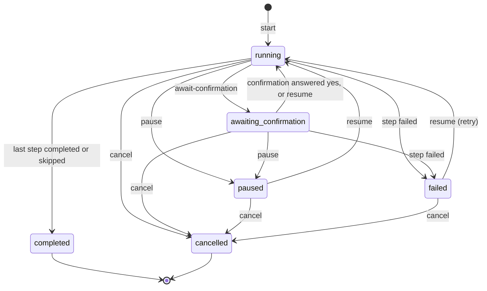
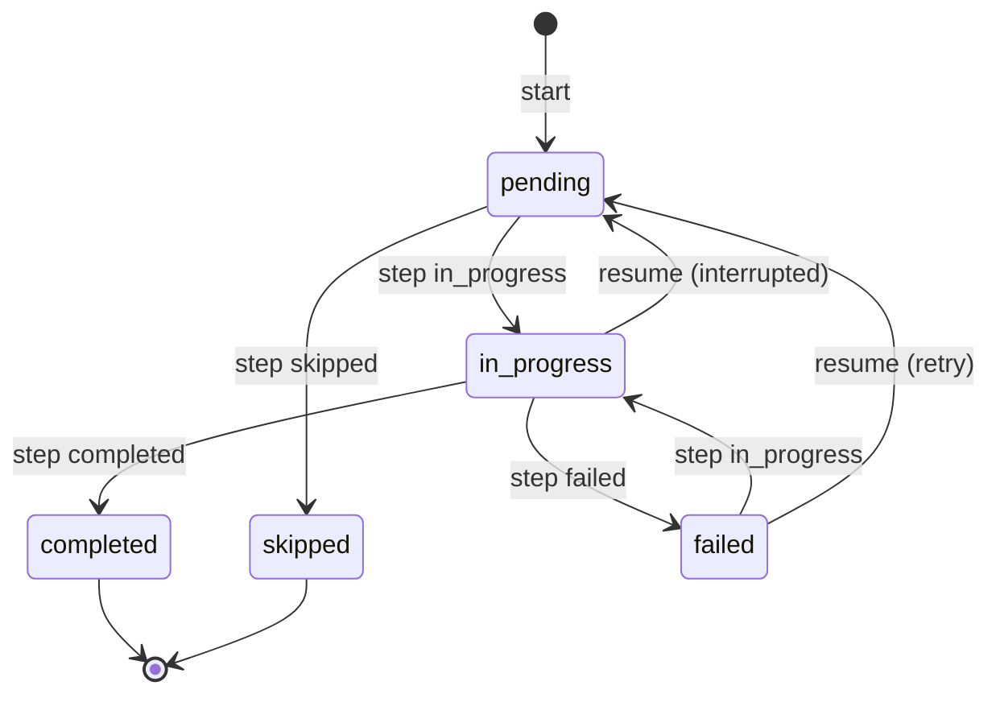

# Workflows

Internal documentation for the `workflow` service area (epic `E80`). This file is written against the
implementation, not the plan: where a piece does not exist yet it says so. Story `E80_S01` (this document's
owner) covers the definition format, the validator and the loader. Durable runs (`E80_S02`), the step executors
(`E80_S03`) and compute/render steps with their output registry (`E80_S04`) extend the sections below as they
land; the `j.workflow` skill (`E80_S05`), the worked example and the end-to-end suites (`E80_S06`) are described in
"Worked example: authoring and running `example-report`" and "Known limits" near the end.

## Overview

A **workflow** is a declarative, linear, validated definition file: an ordered list of steps, each of one of five
types, with optional run inputs, optional checkpoints and optional declared outputs. It is the long-horizon
sibling of a playbook (see "How workflows differ from playbooks"). Specific workflows (Sprint `E81`, Roadmap
`E82`, the Assertion refresh flow `E83`, or a project's own) are configured from the same building blocks instead
of being hand-built.

Where the files live:

| What | Where |
|------|-------|
| Format contract (single machine-readable source) | `templates/workflow-schema.json` |
| Builtin, framework-owned definitions | `templates/workflows/*.json` |
| Project-local definitions | `project/.workflows/<id>.json` (parallel to `project/.playbooks/`) |
| Machinery | `scripts/workflow/` |
| Output type registry (shared with playbooks) | `templates/playbook-types.json` |

A definition's filename without `.json` must equal its `id`, as for playbooks. The scripts under
`scripts/workflow/` are shared by every workflow-consuming skill and are authored in the root directories only;
`.claude/` and `.agents/` are generated copies.

`validate-workflow.sh` and `load-workflows.sh` read their rules and locations from the schema and from
`lib.sh` (the sourced library beside them); nothing in them hardcodes a working-file path. `run-state.sh` (the run-state store,
`E80_S02`), `step-skill.sh` and `step-playbook.sh` (the agent-driven step payloads, `E80_S03`) and
`verify-output.sh` (the typed output check, `E80_S03`) sit beside them; each documents itself in its own header
comment, which is the reference for those parts.

## Definition format

Version 1 of the format (`schema_version` 1 in the schema file).

**Top-level keys.**

| Key | Required | Meaning |
|-----|----------|---------|
| `id` | yes | Lowercase letters, digits and single hyphens (`^[a-z0-9]+(-[a-z0-9]+)*$`); equals the filename without `.json`. |
| `name` | yes | Display name. |
| `description` | yes | One or two sentences. |
| `steps` | yes | Non-empty ordered array of step objects. |
| `keywords`, `examples` | no | Discovery text, as for playbooks. |
| `inputs` | no | Array of named run parameters, each `{name, description?, default?}`; `name` matches `^[a-z][a-z0-9_]*$`. |

**Every step** carries `id` (unique within the file, `^[a-z][a-z0-9_]*$`) and `type`, plus the optional
`checkpoint` (a boolean) and `outputs`.

**The five step types and their fields.** The first column of fields is required, the second optional.

| `type` | Required | Optional | Field kinds |
|--------|----------|----------|-------------|
| `skill` | `skill` | `args` | `skill`: string (`j.<name>`); `args`: string map |
| `playbook` | `playbook` | `args` | `playbook`: string (a playbook id); `args`: string map |
| `confirm` | `prompt`, `options` | none | `prompt`: string; `options`: array of strings |
| `compute` | `command` | `args` | `command`: string; `args`: array of strings |
| `render` | `template` | `inputs` | `template`: string; `inputs`: string map |

**Fields the executors read that the schema does not declare.** The validator ignores unknown keys, and two
executors read one key each that `templates/workflow-schema.json` does not list, so the table above is not the whole
contract:

- `renderer` on a `render` step (`json` or `markdown`; absent means the `template` extension decides). The
  `example-report` workflow sets `"renderer": "markdown"`. `html` or any other value is rejected when the step runs.
- `timeout_seconds` on a `compute` step (a positive integer; the default is 60 seconds, defined in
  `scripts/workflow/run-compute.sh`). A step that overruns is killed and fails with `timed out after Ns`.

Because the validator does not check either, a misspelt value surfaces as a failed step at run time, not at
validation time.

**`checkpoint: true`** marks a step whose completion is a durable resume point. Checkpoints only mean something
to a run (`E80_S02`); the definition just declares where they are.

**`outputs`** on a step is an array of `{name, kind, type}`:

- `name` matches `^[a-z][a-z0-9_]*$` and is unique within the step;
- `kind` is `artifact` (a produced file, such as a sprint document) or `data` (a typed value other steps and
  workflows consume);
- `type` is a key of `types` in `templates/playbook-types.json` (today `text`, `id_list`, `file_list`,
  `ranked_list`, `error_table`). The schema lists no type names of its own, so there is no second type system.

**Substitution.** Inside step string values a definition may reference run inputs and earlier outputs:

- `${inputs.<name>}`: a run input declared in the definition's `inputs`;
- `${steps.<step_id>.outputs.<output_name>}`: an output declared by a step that appears strictly **earlier** in
  `steps`.

References are valid in every string value of a step except `id`, `type`, `skill`, `playbook`, `outputs` and
`checkpoint` (that is, in `args`, `options`, `prompt`, `command`, `template` and a render step's `inputs`). The
earlier-steps-only rule is what keeps a definition linear: a reference to the step itself, to a later step, to an
undeclared input or to an output the referenced step does not declare is rejected. Any other `${...}` (a shell
variable inside a compute command, say) is not a reference and is left alone.

**The example below is complete and valid.** `tests/workflow-doc-sections.bats` extracts it from this file and
runs `validate-workflow.sh` on it, so it cannot drift from the validator. The validator checks shape and
references, not that a named skill, playbook, `command` or `template` exists; the compute command
(`rank-items.sh`) and the template (`report.md`) here are illustrative names. What a `compute` command and a `render` template may resolve to is
specified by `E80_S04`.

<!-- workflow-example:begin -->
```json
{
  "id": "board-ranking-report",
  "name": "Board ranking report",
  "description": "Survey a scope of the board, tidy it, rank the items, confirm with the user and save a report.",
  "keywords": ["ranking", "report"],
  "examples": ["rank the open items of an epic and save a report"],
  "inputs": [
    { "name": "scope", "description": "Epic or story id to survey", "default": "E80" }
  ],
  "steps": [
    {
      "id": "survey",
      "type": "skill",
      "skill": "j.status",
      "args": { "scope": "${inputs.scope}" },
      "checkpoint": true,
      "outputs": [{ "name": "item_ids", "kind": "data", "type": "id_list" }]
    },
    {
      "id": "tidy",
      "type": "playbook",
      "playbook": "board-hygiene"
    },
    {
      "id": "rank",
      "type": "compute",
      "command": "scripts/rank-items.sh",
      "args": ["${steps.survey.outputs.item_ids}"],
      "checkpoint": true,
      "outputs": [{ "name": "ranking", "kind": "data", "type": "ranked_list" }]
    },
    {
      "id": "approve",
      "type": "confirm",
      "prompt": "Save a report ranking ${steps.survey.outputs.item_ids}?",
      "options": ["Save", "Skip"]
    },
    {
      "id": "report",
      "type": "render",
      "template": "report.md",
      "inputs": {
        "scope": "${inputs.scope}",
        "ranking": "${steps.rank.outputs.ranking}"
      },
      "outputs": [{ "name": "report", "kind": "artifact", "type": "text" }]
    }
  ]
}
```
<!-- workflow-example:end -->

The schema file also declares the identifier patterns above. The v1 validator does not enforce the id and name
patterns or the field kinds in the table (its header lists this under "Not checked"), so the table is the contract
authors write to and the validator is the safety net for the structural and referential errors listed in the next
section.

## Validating and loading

### `scripts/workflow/validate-workflow.sh <file>`

Checks one definition against the schema; the rules (required keys, per-type required fields, output entry shape,
substitution pattern) are read from `templates/workflow-schema.json`, so adding a step type or a required field is
a schema edit.

- **Exit 0**: valid; nothing is printed.
- **Exit 1**: invalid. One line per problem on stderr, all problems of the file in one run:
  `<file>: <field path>: <reason>`, for example `wf.json: steps[2].type: unknown step type 'branch'`. The field
  path is jq-like from the definition root (`id`, `steps[3].command`), or `(root)` for the whole document. Stdout
  stays empty.
- **Exit 2**: the validator could not run (wrong argument count, `jq` missing, unreadable or non-JSON file,
  unusable schema or type registry).

It rejects: a missing `id`, `name`, `description` or `steps`; an unknown step `type`; a duplicate step `id`; a
missing type-specific required field; an output with an invalid `kind` or a `type` that is not in the registry; a
duplicate output name within a step; and any `${...}` reference to an undeclared input, an unknown step, the step
itself, a later step or an output the step does not declare, or one that is malformed.

### `scripts/workflow/load-workflows.sh`

The single source of workflow definition data; nothing else re-scans the directories.

- Bare, it prints one JSON array, sorted by `id`. Each element is a valid definition plus `source` (`builtin` or
  `project`) and `file` (the path scanned). With nothing to load the output is `[]`.
- It scans `templates/workflows/` first, then `project/.workflows/`, running the same validator over both. <!-- check-doc-refs: ignore -->
- **A missing directory is a silent no-op**: no warning, exit 0. A project with no custom workflows is the common
  case, and a fresh checkout's builtin directory holds only `.gitkeep`.
- **Collision rule**: when a project definition has the `id` of a loaded builtin, the builtin wins, the project file
  is skipped and stderr names both file paths and the id. Two files of the same source with one `id`: the
  lexicographically first file wins, and stderr names both. Only validated files take part, so an invalid builtin
  never shadows a project definition.
- **Invalid files are dropped**, with one warning block on stderr naming the file and the validator's reasons; every
  other definition still loads.
- `load-workflows.sh lookup <id>` builds the same catalog and prints the one matching definition (with `source`
  and `file`). An id that is not in the catalog, including one that exists only in a dropped file, prints nothing
  on stdout and exits 2 with a message naming the id and listing the available ids; a missing or empty `<id>` is a
  usage error, also exit 2. (`lookup` is added by `E80_S01_T06`.)
- Exit 0 means the catalog was printed; exit 2 means the loader could not run (bad arguments, `jq` missing, a
  location or the validator unresolvable, or the schema or type registry unusable).

### `scripts/workflow/resolve-refs.sh <run_id> <step_id>`

The runtime half of the reference syntax (`E80_S03_T03`). It reads the run's state (`step-state.sh get`), looks up
the run's workflow (`load-workflows.sh lookup`), takes the step by id and prints it as JSON, keys sorted, with
every `${inputs.<name>}` and `${steps.<step_id>.outputs.<output_name>}` replaced. Every string in the step is
substituted (including those in `args`, `options` and a render step's `inputs`) except `id`, `type`, `skill`,
`playbook`, `outputs` and `checkpoint`. Run inputs come from the state's `inputs`; step outputs come only from
`step-state.sh get-output`.

- **Single pass.** All references are resolved first and then substituted in one pass, so a substituted value is
  never rescanned: an input or output whose text looks like `${inputs.x}` stays literal.
- **All or nothing.** Output is byte-identical across runs. Any failure prints nothing on stdout.
- **Exit 1** (message names the reference and the cause): an input the run does not have; an output of a step that
  is `skipped` or `failed`; a step that has not completed (`pending`, `in_progress`, including the step itself); an
  output the step has not produced or does not declare; a step the run does not have; a malformed reference.
- **Other exits**: `2` usage, an invalid id, an unknown step or a workflow that can no longer be looked up; `3` run
  not found; `4` corrupt state; `5` `jq` missing or lock timeout.
- **Not a reference, not touched.** Any `${...}` outside the two namespaces (`${HOME}`) is emitted verbatim.
- **No escape syntax.** The grammar defines none (no `$${`, no backslash), and the validator checks every
  `${inputs|steps...}` token wherever it occurs, so an author cannot write a literal reference today. The script
  implements no escape rather than inventing one; the follow-up (a grammar amendment in the schema, validator and
  this document, then a one-line extension here) is recorded in the rapport
  `E80_S03_T03-no-escape-syntax-in-grammar`.

**Where the grammar lives.** The single source of truth is `substitution.pattern` in
`templates/workflow-schema.json`; the validator and this script both read it from there (through `lib.sh`'s
`workflow_schema_path`) and neither copies it. One thing is duplicated on purpose: to tell a malformed reference
from text that is not a reference, both scripts hard-code the same looser token regex
`\$\{(?:inputs|steps)(?:\.[^}]*)?\}` (validator: `reference_problems`; here: `_RR_LOOSE`). A token that matches it
but not the schema pattern is malformed. Change the two together.

### The output registry: layout and `scripts/workflow/artifacts.sh register`

Every output a step declares and publishes (the `artifact` outputs of a `render` step, the `data` outputs of a
`skill`, `playbook` or `compute` step) ends up in one registry, so a result can be fetched by
workflow id and output name instead of by hunting for a file. `scripts/workflow/artifacts.sh` is the single writer
and the only script that knows the layout; the executors never build these paths themselves.

- **Layout**, under the `workflow_artifacts` directory (see "Locations and path keys"): one directory per run,
  `<workflow_artifacts>/<workflow_id>/<run_id>/<name>` for each published file, and `outputs.jsonl` beside them, one
  JSON record per output, append-only. One directory per run is what guarantees that a re-run never overwrites an
  earlier run's output.
- **A record** has exactly nine fields: `workflow_id`, `run_id`, `step_id`, `name`, `kind`, `type`, `path`
  (relative to the artifacts directory, so it survives relocating the tree), `created_at` and `sha256`.
- **Who writes.** `artifacts.sh register <workflow_id> <run_id> <step_id> <name> --kind artifact|data --type <type>
  --file <path> [--replace]` copies the file (never moves it). `render-artifact.sh` calls it for every `artifact`
  output of a render step; `complete-step.sh passed` and `run-compute.sh` call it for `data` outputs, both through
  `publish-output.sh` (see "Publishing outputs to the registry from `complete-step.sh passed`" and "Compute steps").
  An author never calls `register` directly.
- **Rules.** Ids and names match `^[A-Za-z0-9][A-Za-z0-9._-]*$` (no `/`, no `..`, no leading `.`); the name
  `outputs.jsonl` is reserved; registering a name already recorded for the run fails unless `--replace` is given, and
  `--replace` only ever swaps the same run's own record. The file and the record are written crash-safely (a
  temporary name then a rename, the record update under `scripts/with-lock.sh`).
- **Exits of `register`.** `0` registered (the record on stdout); `1` rejected (bad id, name, kind or type, missing
  `--file`, or a duplicate name) with nothing written; `2` usage; `3` the artifacts root cannot be resolved; `4` the
  lock or a write failed, with nothing left behind.

### `scripts/workflow/artifacts.sh list | get | latest` (reading the output registry)

The read side of the output registry whose write side is `artifacts.sh register` (`E80_S04_T05`). It is the contract
the sprint artifact (`E81`) and the timeline (`E82`) call, so the output is JSON and the ordering is deterministic.

- `list [--workflow <id>] [--run <run_id>]` prints a JSON array of registry records, each with a `run_status` field,
  sorted by `created_at`, then `run_id`, then `name`. The two filters combine. No match prints `[]` and exits 0.
- `get <workflow_id> <name> [--run <run_id>]` prints one record. With `--run` it returns that run's record whatever
  the run's status, because an explicit run id is an explicit request. Without `--run` it behaves as `latest`.
- `latest <workflow_id> <name>` prints the record from the most recent **completed** run that produced `<name>`
  ("most recent" by `created_at`, tie-broken by `run_id`). Runs that are `failed`, `cancelled`, `running`, `paused`,
  `awaiting_confirmation` or unknown are skipped.
- `--path` (on `get` and `latest`) prints only the absolute path of the published file, for shell callers:
  `cat "$(scripts/workflow/artifacts.sh latest sprint sprint.md --path)"`.
- `run_status` is read at query time from `run-state.sh status <run_id>` and is never stored in the registry, so the
  run store stays the single source of truth for lifecycle. A run whose state cannot be read (missing or corrupt)
  is `unknown`: `list` shows it, `latest` skips it and its error message says why.
- **Exits.** `0` found (or an empty `list`); `5` nothing to return, with a message naming the missing workflow,
  name or run, or saying that the output exists but no run that produced it is completed; nothing is printed on
  stdout on an error. `1` an invalid id, `2` a usage error, `3` the artifacts root cannot be resolved.

### `scripts/workflow/render-artifact.sh <run_id> <step_id>`

Executes one `render` step with no model call (E80_S04_T06). References are substituted by `resolve-refs.sh`; the
`json` renderer then writes the step's `inputs` map as the document (keys sorted, 2-space indent, trailing
newline, byte-identical for the same run state) and publishes it with `artifacts.sh register` for every
`kind: artifact` output. The renderer is the step's optional `renderer` key, else the `template` extension
(`.json`, `.md`); `html` or any unknown renderer is rejected before a file is written. The `markdown` renderer is
described in its own section below. A render error marks the step and run `failed` with a reason that names the reference, publishes
nothing and leaves earlier completed steps alone. Exit codes and the field mapping are in the script header.

### The `markdown` renderer of `render-artifact.sh`

Added by `E80_S04_T07`. It reads the step's `template` file and substitutes `{{...}}` placeholders; publishing,
atomicity and step recording are the `json` renderer's code paths.

- **Placeholders.** `{{inputs.<name>}}` and `{{steps.<step_id>.<output_name>}}`, names matching
  `^[a-z][a-z0-9_]*$`, no whitespace inside the braces. Each is resolved by `resolve-refs.sh`'s own resolver (it is
  the same value `${inputs.<name>}` / `${steps.<step_id>.outputs.<output_name>}` gives), so a missing input, an
  output never stored, and a failed, skipped or not yet completed step are refused exactly as in the `json`
  renderer. The step's own `inputs` map is not used by this renderer.
- **Single pass, plain text.** A substituted value is never scanned again: a step output that contains
  `{{inputs.x}}` appears verbatim, so an output cannot inject placeholders. `\{{` in the template writes a literal
  `{{`; a `}}` outside a placeholder is plain text.
- **Strict.** An unresolvable placeholder, an unterminated `{{` (no `}}` on the same line) and an unsupported or
  malformed placeholder (a namespace other than `inputs` and `steps`, `{{}}`, a bad name) each fail the step and
  the run, publish nothing, and name the placeholder and the template line number in the message and the run
  history.
- **Template path.** One plain token (letters, digits and `. _ @ + / -`), relative to the project anchor, no
  absolute path, no `..` segment, and the symlink-resolved path must lie inside the anchor; otherwise it is
  rejected before the file is opened. The recommended home is the `templates` directory inside the workflows
  directory (`resolve-root.sh get workflows`).
- **Deterministic.** No timestamp or environment value; the template's line endings are kept; the file ends in
  exactly one newline (a missing one is added, trailing empty lines collapse); a template with a NUL byte is
  rejected. The same run state renders byte-identically.

### Locations, the consumer install and `resolve-root.sh`

No script hardcodes a working-file path. `lib.sh` (in `scripts/workflow/`, sourced and therefore not executable) is
the one place that answers where things live:

- **Package files** (the schema, the type registry, `templates/workflows/`) are found relative to the checkout the
  script lives in, and, when that has no `templates/` directory, in the consumer install
  `<project anchor>/node_modules/@jenga-ai/agent` (the `E46` fallback). The anchor comes from
  `scripts/resolve-root.sh`.
- **The project directory** is `.workflows` inside the working-file tree, with the anchor and the tree name
  (`project` or the dot-prefixed variant) both read from `scripts/resolve-root.sh`, so it follows
  `JENGA_PROJECT_ROOT` and a relocated tree.
- `JENGA_WORKFLOWS_TEST_ROOT` points every path at a synthetic tree for tests, in the manner of
  `JENGA_PLAYBOOKS_TEST_ROOT`. Never set it in a real invocation.

### Path keys

Three keys of the `paths` map in the project's workflow registry (`scripts/resolve-root.sh` reads it) locate
everything the workflow machinery writes. Scripts and skills ask for them with `scripts/resolve-root.sh get <key>`
and never spell the directory out, so they follow `JENGA_PROJECT_ROOT` and a relocated tree.

| Key | Holds | Written by |
|-----|-------|------------|
| `workflows` | project-local workflow definitions, `<id>.json` (plus an optional `scripts` directory a `compute` command may live in, and a `templates` directory for markdown templates) | the author |
| `workflow_runs` | one state file per run, `<run_id>.json`, with its lock directory beside it | `run-state.sh` only |
| `workflow_artifacts` | the output registry described above | `artifacts.sh register` only |

The defaults, with the working-file tree named `project`, are:

```
workflows           project/.workflows
workflow_runs       project/data/workflow-runs
workflow_artifacts  project/data/workflow-artifacts
```

A relocated tree uses the dot-prefixed name (`.project/...`), and a project may override any key in the `paths` map
of its own registry. The runs and artifacts directories are created on first use (`start` creates the runs
directory, the first `register` the artifacts directory); `workflows` is never created by the machinery.

## How workflows differ from playbooks

A playbook (`E53`) is an ordered chain of skill names that runs once. Its state is a temporary file:
`run-playbook-step.sh init` creates it with `mktemp` as `jenga-playbook-run-XXXXXX.json`, and it does not outlive
the session. A workflow differs in five ways:

1. **Durable run state.** A workflow run has its own identity (`wf-<workflow_id>-<UTC timestamp>-<6 hex>`) and a
   state file that persists in the `workflow_runs` directory (one JSON file per run, see "Run lifecycle and
   resume"), instead of a `mktemp` file.
2. **Checkpoints and resume across sessions.** Steps can be marked `checkpoint: true`, and a run paused or
   interrupted in one session can be resumed in a later one with `j.workflow resume <run_id>`. A playbook cannot
   be resumed once its temporary file is gone.
3. **Five step types.** `skill`, `playbook`, `confirm`, `compute` and `render`, where a playbook is skills only.
4. **Declared artifact and data outputs.** A step declares typed outputs, either `artifact` (a produced file) or
   `data` (a value for later steps and other workflows), so a result can be retrieved by name from the output
   registry (`artifacts.sh latest`, `get`).
5. **A longer horizon.** Playbooks suit one implementation; workflows coordinate work that spans sessions and
   several kinds of step.

This definition format deliberately reuses three playbook pieces rather than reinventing them:

- **The type registry**, `templates/playbook-types.json`. An output `type` is a key of that registry, verified
  with the same validator (`scripts/workflow/verify-output.sh` wraps `scripts/validate-typed-object.sh`).
- **The loader conventions** of `skills/jenga/scripts/load-playbooks.sh`: a builtin directory plus a project-local
  directory merged into one catalog, one validation pipeline for both, builtin wins on an `id` collision with a
  stderr warning, a bad file dropped with a warning instead of poisoning the catalog, and a test-root override.
- **`run-playbook-step.sh` for `playbook` steps.** A `playbook` step reuses the `E53` machinery unchanged: the
  id is resolved with `load-playbooks.sh lookup` and the agent runs it as `/jenga` does
  (`scripts/workflow/step-playbook.sh`). Because playbook state is not durable, a playbook is one unit of a
  workflow; an interruption inside it resumes by starting that playbook step again from its first step.

Runs themselves (start, advance, pause, resume, cancel) are described in "Run lifecycle and resume" and the
sections after it.

## Non-goals for v1

The format is linear. These are deliberately absent and are listed in the schema's `non_goals_v1`:

- **Branching**: no step chooses between next steps.
- **Parallel steps**: steps run one after another, in order.
- **Conditionals**: no step is skipped or run on a condition.

A `confirm` step is a gate that pauses for the user, not a branch: it does not change which steps follow.
Adding any of the three later would be a new schema version.

## How E81, E82 and E83 use this

These are the intended shapes, not commitments: the epics decide their own step lists when they are broken down
(`E83_S04` already has one, noted below; `E81` and `E82` have no stories yet). The workflow ids, output names and
file names below are illustrative; the step types and the registry commands are what each epic is expected to depend
on. In each case the run is driven by `j.workflow run <id>` and the result is read back from the output registry.

**Sprint (`E81`)** establishes which board items are prioritised, ranks them by scope/complexity and by dependencies,
decides who carries out what, and saves a sprint artifact.

- Step types, in order: `compute` (rank the items; a deterministic script, not model judgment), `confirm` (the user
  accepts the selection and the assignments), `render` (the sprint artifact, an `artifact` output). A `skill` step
  is possible where a human-facing skill gathers input.
- Registry commands: the sprint workflow itself calls none. Its `render` step publishes the artifact, and the
  consumers read it with `artifacts.sh latest <sprint workflow id> <artifact name>`, adding `--path` when they only
  need the file.
- The definition would be a project-local file under `project/.workflows/` (for example `project/.workflows/sprint.json`; the name is E81's choice). <!-- check-doc-refs: ignore -->
- Assignees come from the team configuration `project/configs/team.json`, which E81 creates. <!-- check-doc-refs: ignore -->

**Roadmap (`E82`)** assembles multiple sprints along a timeline and builds on the sprint artifacts of `E81`.

- Step types, in order: `compute` over the published sprint artifacts (the script lists them with
  `artifacts.sh list --workflow <sprint workflow id>`, picks the records it wants, and reads each file through
  `artifacts.sh get <sprint workflow id> <name> --run <run_id> --path`, or `latest` for the newest completed sprint),
  then `render` (the roadmap artifact). A `confirm` step is possible before saving.
- Only completed runs are visible through `latest`; a failed or cancelled sprint run never feeds the roadmap.
- The dashboard timeline view of `E82` reads the saved artifacts with `artifacts.sh latest ...`. It is a reader of the
  registry and not a workflow step. HTML or dashboard rendering is out of scope for `E80` (see "Known limits").

**Assertion refresh flow (`E83`)** is the one part of `E83` that depends on `E80`: it updates the test-to-architecture
links when tests or the knowledge graph change.

- Step types, in order: `compute` (extract the links by script), then `render` (write the overlay data as an
  artifact). A `confirm` step is possible before overwriting existing links.
- Registry commands: the `render` step publishes; the reader of the overlay data calls
  `artifacts.sh latest <refresh workflow id> <artifact name> --path`.
- `E83_S04` currently plans three steps (check, extract, report) as `compute`, `compute`, `render`, so its list wins over the two-step shape above. The planned files are the workflow definition `project/.workflows/test-links-refresh.json` and the scripts `scripts/check-test-links.sh` and `scripts/extract-test-links.sh`. <!-- check-doc-refs: ignore -->
- A `compute` command must live under an allow-listed root (`scripts/`, `skills/<name>/scripts/`, or the workflows
  directory's `scripts/`), which is why those two scripts live under `scripts/`.
- The spike, the link method and the read-only overlay on the Architecture tab are not workflows.

**Files these epics have not created yet.** `check-doc-refs.sh` fails on a backticked path that does not exist. The
paths above that belong to `E81` and `E83` do not exist yet, so the lines naming them end in the
`<!-- check-doc-refs: ignore -->` marker, which makes the checker skip that whole line. The full list of markers in
this file, with the reason for each, is under "Documentation reference check". Remove the markers when the files land.

None of the three is expected to need a `playbook` step; that type is there for projects chaining existing
playbooks.

## Public mirror

`project/.workflows/` is blocklisted in `.publicignore` (`E80_S01_T08`) with the same reasoning as <!-- check-doc-refs: ignore -->
`project/.playbooks/`: project-local definitions are per-project, so shipping ours would push private workflow
tooling downstream and land in the directory a consumer uses for their own. The framework-owned builtins in
`templates/workflows/` are not blocklisted and do ship. Nothing is stranded by the exclusion because
`load-workflows.sh` treats a missing `project/.workflows/` as a silent no-op. The reasoning is in <!-- check-doc-refs: ignore -->
`project/documentation/public-mirror-content-parity.md` ("Project-local workflows are private"), and the run-state
directory is blocklisted separately by `E80_S02`.


### Git treatment

Decided in `E80_S04_T11`: the artifacts directory (the `workflow_artifacts` path, `project/data/workflow-artifacts`
by default, resolved through `scripts/resolve-root.sh get workflow_artifacts`) is **tracked in git** and
**excluded from the public mirror**. This is the opposite of the run-state directory, which `E80_S02` ignores.

- **Why tracked.** Run state is private operational state, resumed per machine, so a committed run would be resumed
  on every clone. A published artifact is the reverse: a deliverable (a sprint plan, a roadmap) that other tools and
  collaborators read, including the dashboard timeline of `E82`. If the directory were ignored, `latest` would
  return nothing on a fresh clone, and a team could not share a sprint plan through the repository. The directory
  carries an empty `.gitkeep` so it exists on a fresh clone before the first run, and no `.gitignore` rule covers it;
  `project/data/workflow-runs/` handling is unchanged.
- **Retention trade-off.** Every run's artifact is retained and tracked, so the directory grows with each run and
  its history grows the repository. Pruning old artifacts is a future concern and is out of scope here.
- **Mirror treatment.** `.publicignore` lists `project/data/workflow-artifacts/` (the subdirectory only, never
  `project/data/`, which holds shipped files such as `baselines.json`), because project-specific plans must not leak
  downstream, the same reasoning as `project/board/`. `scripts/check-publicignore-match.sh` reports its `.gitkeep`
  as `BLOCKED`.
- **Guarded by a test.** `tests/workflow-artifacts-gitignore.bats` asserts the treatment from the real repository
  files. Its subject is blocklisted from the mirror, so the test is blocklisted too, and it skips when
  `.publicignore` is absent.

## Running a workflow: lifecycle, resume and the executors

Everything above describes a definition. This part describes a run of one: the durable state, how it moves between
statuses, how it resumes in a later session, and the scripts that advance it. The `j.workflow` skill
(`skills/j-workflow/SKILL.md`) is only the driver; every transition, substitution, verification and state write
happens in the scripts. Each script documents itself in its own header comment, and where this document and a header
differ, the header wins.

### Step type reference

| Type | Who executes it | Produces | Notes |
|------|-----------------|----------|-------|
| `skill` | the driving agent, invoking `j.<name>` with the resolved `args` as `key=value` pairs | whatever the step declares as `outputs`, reported with `complete-step.sh passed` | a skill that is unknown is a dispatch-time `error`, not a failed step |
| `playbook` | the driving agent, exactly as `/jenga` runs a matched playbook | the same, as one overall outcome | restarts as a unit on resume, see "The playbook limit" |
| `confirm` | the user, through a gate persisted in the run state | the answer, as the step's `answer` output | a gate pauses, it does not branch |
| `compute` | `next-step.sh`, through `run-compute.sh`, with no model call | the command's stdout, as the single declared output | command confined to the allow-listed script roots, 60 second default timeout |
| `render` | `next-step.sh`, through `render-artifact.sh`, with no model call | a published file, for each `artifact` output | `json` and `markdown` renderers only |

The fields of each type are in "Definition format"; what each hands the agent is in "Payload per step type" below.

### Run lifecycle and resume

**Where a run lives.** One state file per run, `<workflow_runs>/<run_id>.json` (see "Path keys"), written only by
`scripts/workflow/run-state.sh` through a locked, atomic writer, with a lock directory beside it
(`<run_id>.json.lock.d`). A file that is empty, not a single JSON object, lacks one of the twelve required top-level
keys, or has a `schema_version` other than 1 is corrupt: it is never printed, never listed as a run and never
modified. The state file format is specified in the header of `scripts/workflow/run-state.sh`, which is the single
source for it; in short it holds `run_id`, `workflow_id`, `definition_hash`, the effective `inputs`, the run `status`,
`created_at` and `updated_at`, `last_checkpoint`, `definition_change_ack`, the `steps` (each with its `status`,
`checkpoint` flag, timestamps and `outputs`) and an append-only `history` of status moves.

**Starting.** `run-state.sh start <workflow_id> [--input k=v ...]` prints only the new run id. It loads and validates
the definition, rejects a declared input that has neither a value nor a `default` and any input the definition does
not declare (one message naming every offender, exit `2`), stores the effective inputs (a default fills in what was
not supplied), records the hash of the definition file, and writes the run with `status: running`, every step
`pending` and `last_checkpoint: null`. Nothing is written unless every check passed.

**Run statuses and the legal moves.** The transition table lives in one place in `run-state.sh`
(`assert_transition`); every command that changes `status` goes through it, and moving to the same status is
refused.

| From | Legal moves to |
|------|----------------|
| `running` | `paused`, `awaiting_confirmation`, `failed`, `completed`, `cancelled` |
| `awaiting_confirmation` | `running`, `paused`, `failed`, `cancelled` |
| `paused` | `running`, `cancelled` |
| `failed` | `running` (a retry, through `resume`), `cancelled` |
| `completed` | none (terminal) |
| `cancelled` | none (terminal) |

**Step statuses.** `pending -> in_progress` (or `skipped`), `in_progress -> completed` or `failed`, and
`failed -> in_progress` (in practice a retry starts from `pending`, because `resume` resets a failed step first; see "Run state"). `completed` and `skipped` are final for the run: the store refuses any move
out of them, which is the guarantee that a completed step is never silently run again. A step cannot start while an
earlier step is neither `completed` nor `skipped`, so execution is strictly linear.

**Commands.** `status <run_id>` prints the state; `list` prints one tab-separated line per run
(run id, workflow id, status, updated time); `pause` moves `running` or `awaiting_confirmation` to `paused` (a step
that is `in_progress` stays so, and the agent that was executing it still reports its result); `cancel` moves any
non-terminal run to `cancelled` and leaves its steps and file as they are. `j.workflow` exposes these as
`status`, `list`, `pause`, `cancel` and `resume`, and asks for a numbered confirmation before cancelling.

**Checkpoints.** A step with `checkpoint: true` records its id in `last_checkpoint` in the same atomic write that
marks it `completed`. Completing a non-checkpoint step never changes it, and a skipped step never sets it.

**Resume.** `run-state.sh resume <run_id> [--allow-definition-change]` works from a brand-new process and session
given only the run id, because everything it needs is in the state file and the current definition. It prints one
JSON object (`run_id`, `status`, `resumed_from_checkpoint`, `next_step`, `definition_changed`). In order:

1. **Which runs may resume.** `paused`, `awaiting_confirmation` and `failed` move to `running`. `completed` and
   `cancelled` are refused. A `running` run is refused as already running, unless a step is `in_progress` (the session
   that was driving it ended without reporting): that case is recovered and recorded in the history.
2. **Definition guard.** The definition is looked up again and hashed. If it no longer exists or no longer validates,
   or if it changed since the run started and `--allow-definition-change` is absent, resume exits `6` and changes
   nothing. With the flag the resume proceeds when every step id in the state still exists in the new definition (a
   missing one is exit `6` even with the flag), and the acknowledgement is recorded in `definition_change_ack` and the
   history. The stored hash is not rewritten, so a later resume without the flag sees the change again. `j.workflow
   resume` shows the exit `6` message and only passes the flag after the user picks that option.
3. **Step recovery.** Every step that is `in_progress` (interrupted) or `failed` is reset to `pending`, with its
   timestamps cleared and a note saying why. This applies to every legal resume, because a new session has no live
   executor.
4. **Next step.** The first step in definition order after the one named by `last_checkpoint` (from the first step
   when there is none) that is neither `completed` nor `skipped`. A completed step is never reported, and none is
   executed twice: a resumed run does not run its finished compute or render steps again. When no step is left the
   run moves to `completed` and `next_step` is `null`.

Resume exits: `1` not resumable, `2` usage, `3` unknown run, `4` corrupt state, `5` lock timeout, `6` definition
changed or gone. Every refusal writes nothing.

**Failure and retry.** A failed step (reported by the agent, or by a compute or render executor) moves the run
`running -> failed`, and the dispatcher then answers `halted` on every call. The only way forward is `resume`, which
resets the failed step to `pending`; there is no skip-ahead.

### Run state

The parts above say what a run does; this part is the reference for the store itself, `scripts/workflow/run-state.sh`
(`E80_S02`): the state file, the lifecycle as a diagram, every command and exit code, and the locking. It repeats
nothing from "Run lifecycle and resume"; the rules for starting, the checkpoints, the resume order and failure and
retry are there and are not restated. The header comment of the script is the single source for the file format
(where this section and the header differ, the header wins).

#### Lifecycle diagram

The edges below are exactly the rows of "Run statuses and the legal moves" (13 moves, plus creation by `start`), and
`assert_transition` in the script is the only place they are defined. Moving to the same status is never legal.



`completed` and `cancelled` are terminal. A paused run never moves to `failed` or `completed` on its own: it records a
step result (see the `step` row below) and stays `paused`, and `resume` then settles the run, because the table has
no `paused -> failed` or `paused -> completed` edge.

The five step statuses and their moves are the ones in "Step statuses". The diagram adds the two resets that `resume`
performs on its own, which are not a `step` call:



`completed` and `skipped` are final for the run. `failed -> in_progress` is in the store's table, but a run with a
failed step is `failed` and refuses step calls, and `resume` resets that step to `pending` first, so in practice a
retry shows as `pending -> in_progress`.

#### State file, `schema_version` 1

One JSON object. All twelve top-level keys are required (a `null` counts as present). Fields:

| Field | Type | Meaning |
|-------|------|---------|
| `schema_version` | number | must be exactly `1`; any other value makes the file corrupt |
| `run_id` | string | the file's base name, `wf-<workflow_id>-<UTC yyyymmddThhmmssZ>-<6 hex>` |
| `workflow_id` | string | the definition this run executes |
| `definition_hash` | string | SHA-256 of the definition file at start (normalised with `jq -S -c .`, so key order and whitespace do not matter); compared by `resume` and never rewritten |
| `inputs` | object | the effective input values: supplied ones, plus declared defaults |
| `status` | string | one of the six run statuses |
| `created_at` | string | UTC ISO 8601, set once by `start` |
| `updated_at` | string | UTC ISO 8601, set by every successful write |
| `last_checkpoint` | string or `null` | id of the last completed step that has `checkpoint: true`; `null` until one completes |
| `definition_change_ack` | object or `null` | `{at, from_hash, to_hash}` once `resume --allow-definition-change` accepted a change; `null` otherwise |
| `steps` | array | one entry per definition step, in definition order (below) |
| `history` | array | append-only `{at, from, to, note}` for every run status move; the first entry is `from: null, to: running, note: "started"` |

Each `steps` entry holds `id`, `type` and `checkpoint` (copied from the definition at start; `checkpoint` is `true`
only for the boolean `true`), `status` (one of the five step statuses), `started_at` (first `in_progress`, kept on a
retry) and `finished_at` (set on `completed`, `failed` and `skipped`, cleared when a failed step is reset) as UTC
ISO 8601 or `null`, and `outputs`. `outputs` is `{}` at start and maps an output name to a string value. The store
only reserves it and accepts `step ... completed --output name=value`; it is filled by the output work of `E80_S03`
and `E80_S04` (`step-state.sh set-output`, called from `complete-step.sh passed` and the compute executor), which
also publishes the same values to the output registry (see "Publishing outputs to the registry from
`complete-step.sh passed`"). A step may also carry an optional `note` string (written by `step --note`, or by
`resume` when it resets the step). A run id matches `^[A-Za-z0-9._-]+$`, may not contain `..` and may not start with
a dot, so it can neither leave the runs directory nor name a hidden file.

A complete example, taken from a real run of the builtin `example-report` workflow (`items.json` is the run input)
stopped while the `summarise` step is executing. The `approve` gate was answered and `select` is the last checkpoint.
`status` prints keys sorted, as here:

```json
{
  "created_at": "2026-10-25T18:02:20Z",
  "definition_change_ack": null,
  "definition_hash": "0c0625289c5997cf47ec5a2d7330a0608881399b19f2bf6a7faffd7511e2f5fe",
  "history": [
    {"at": "2026-10-25T18:02:20Z", "from": null, "note": "started", "to": "running"},
    {"at": "2026-10-25T18:02:21Z", "from": "running", "note": "awaiting confirmation: step approve", "to": "awaiting_confirmation"},
    {"at": "2026-10-25T18:02:21Z", "from": "awaiting_confirmation", "note": "confirmation answered: step approve completed", "to": "running"}
  ],
  "inputs": {"source": "items.json"},
  "last_checkpoint": "select",
  "run_id": "wf-example-report-20261025T180220Z-2bfadc",
  "schema_version": 1,
  "status": "running",
  "steps": [
    {"checkpoint": true, "finished_at": "2026-10-25T18:02:20Z", "id": "select", "outputs": {"item_ids": "[\"a\",\"b\"]"},
     "started_at": "2026-10-25T18:02:20Z", "status": "completed", "type": "compute"},
    {"checkpoint": false, "finished_at": "2026-10-25T18:02:21Z", "id": "approve", "outputs": {},
     "started_at": "2026-10-25T18:02:20Z", "status": "completed", "type": "confirm"},
    {"checkpoint": false, "finished_at": null, "id": "summarise", "outputs": {},
     "started_at": "2026-10-25T18:02:21Z", "status": "in_progress", "type": "compute"},
    {"checkpoint": false, "finished_at": null, "id": "report", "outputs": {},
     "started_at": null, "status": "pending", "type": "render"}
  ],
  "updated_at": "2026-10-25T18:02:21Z",
  "workflow_id": "example-report"
}
```

A file that is empty, not a single JSON object, lacks one of the twelve keys or has another `schema_version` is
corrupt, as described in "Where a run lives".

#### Command reference

Every command is `scripts/workflow/run-state.sh <command> ...`. Failures print nothing on stdout; the reason goes to
stderr. A bare call, an unknown command or an unknown flag prints the usage on stderr and exits `2`; `-h` and `--help`
print it on stdout and exit `0`.

| Command | Arguments | stdout on success | What it does |
|---------|-----------|-------------------|--------------|
| `start` | `<workflow_id> [--input k=v ...]` | only the new run id | creates the run; checks the definition and inputs first and writes nothing unless all pass |
| `status` | `<run_id>` | the state JSON, pretty, keys sorted | read-only, never locks |
| `list` | none | one line per run: run id, workflow id, status, `updated_at`, tab separated, ordered by `created_at` then run id | read-only; a missing runs directory prints nothing and exits `0`; a corrupt file is a warning on stderr and the exit is `4`, after the full listing |
| `pause` | `<run_id>` | the new status word | `running` or `awaiting_confirmation` to `paused`; an in-progress step stays so |
| `cancel` | `<run_id>` | the new status word | any non-terminal status to `cancelled`; steps and file are left as they are |
| `step` | `<run_id> <step_id> <in_progress\|completed\|failed\|skipped> [--output name=value ...] [--note text]` | the run status after the write | records one step's status, with its checks, in one atomic write; `--output` only with `completed`, repeatable, split on the first `=` |
| `await-confirmation` | `<run_id> <step_id>` | the new status word | for an `in_progress` step, moves the run `running` to `awaiting_confirmation`; the answer is then recorded with `step ... completed` (yes) or `step ... failed` (no) |
| `resume` | `<run_id> [--allow-definition-change]` | one JSON object: `run_id`, `status`, `resumed_from_checkpoint`, `next_step` (`{id, type}` or `null`), `definition_changed` | restarts a paused, awaiting-confirmation or failed run, as described under "Resume" |

`step` refuses, with exit `1` and nothing written: a run that is not `running` or `awaiting_confirmation` (the one
exception is a `paused` run, which accepts `completed` or `failed` for the step that was `in_progress` when the pause
happened), a move the step table does not allow, and a step that starts while an earlier step is not `completed` or
`skipped`. A `failed` step moves a `running` or `awaiting_confirmation` run to `failed`; a `completed` step in an
`awaiting_confirmation` run returns it to `running`, and the call that completes or skips the last step moves
`running` to `completed`. All of those moves are appended to `history` in the same write. `--note` is kept on the step
and added to the history note of any run move the call causes.

Exit codes, the same for every command:

| Code | Meaning | Raised by |
|------|---------|-----------|
| `0` | ok | every command |
| `1` | refused, nothing written: an illegal run or step move, a run that does not accept step reports, an out-of-order start, a step that is not `in_progress`, a run that cannot be resumed; also `start` when no unique run id could be made in 5 tries | `pause`, `cancel`, `step`, `await-confirmation`, `resume`, `start` |
| `2` | usage error: bad or missing argument, invalid run id, unknown step id (the message lists the valid ones), a status word other than the four, a misused `--output` or `--note`, an unknown or invalid workflow, a missing, unknown or repeated input, a rejected update | all commands |
| `3` | run not found | all commands that take a run id |
| `4` | corrupt or unreadable state; nothing is written to the file | `status`, `list` (after the listing), `pause`, `cancel`, `step`, `await-confirmation`, `resume` |
| `5` | lock timeout, nothing written (see "Concurrency") | every writing command |
| `6` | the workflow definition changed since the run started and `--allow-definition-change` was not given, or the definition no longer exists or no longer validates, or a step id of the run is gone from it | `resume` only |

#### Concurrency

Every write goes through one writer, so two processes (two terminals, or the dispatcher and a `pause`) can never
interleave:

1. The whole read-decide-write is run under `scripts/with-lock.sh` on the state file. The lock is an atomic `mkdir` of
   the lock directory `<run_id>.json.lock.d` beside the file (not `flock`, which macOS lacks). The status and the step
   table are decided from the file as it is inside the lock, never from a read taken before it, so two racing calls
   cannot both pass a stale check.
2. The new state is written to a temporary file `.tmp-<run_id>.<pid>` in the same directory, validated with the same
   checks as a read, and only then moved over the state file with `mv`. A rename within one directory is atomic, which
   is why the temporary file is a sibling and not in the system temp directory. A filter that fails or a result that
   is not a valid state removes the temporary file and leaves the state file byte-identical.
3. Reads (`status`, `list`) take no lock. They see either the old file or the new one, never a half-written one.
   Neither the `*.lock.d` directories nor the `.tmp-*` files match `*.json`, so `list` never mistakes them for runs.

**Exit `5`** means the lock could not be taken within `WITH_LOCK_TIMEOUT_SECONDS` (default 30, polled every
`WITH_LOCK_POLL_SECONDS`, default 0.2): another process was holding the run. The command did not run and nothing was
written, so it is safe to repeat. A lock whose holder crashed is reclaimed by `with-lock.sh` once it is older than
`WITH_LOCK_STALE_SECONDS` (default 60), so a stuck `5` clears by itself; do not remove a lock directory by hand while
any process may still be using the run.

#### Why the runs directory is git-ignored and mirror-blocked

Both are already stated, in one place each; nothing new is decided here. Run state is private operational state meant to
span sessions on one machine, so a committed run would be resumed on every clone: `.gitignore` ignores
`project/data/workflow-runs/` apart from its tracked `.gitkeep`, and `.publicignore` lists the same subdirectory (never
`project/data/`, which holds shipped files such as `baselines.json`). See "Git treatment" for the opposite decision on
the artifacts directory, "Public mirror" for the mirror side and "How workflows differ from playbooks" for the contrast
with `run-playbook-step.sh`'s temporary state. `tests/workflow-run-gitignore.bats` guards the ignore rule.

#### Deliberate adjustments to the rules as first proposed

Where the implementation differs from the task text it was built from, the script header records the change; they
are gathered here with their reasons.

- **Step recovery applies to every legal resume**, not only to `running` and `failed` runs. A `paused` or
  `awaiting_confirmation` run can also hold an `in_progress` step (and a `paused` run a step that failed while
  paused), and a new session has no live executor; the step table refuses `in_progress -> in_progress`, so the step must
  go back to `pending` before it can start again.
- **A `running` run with an `in_progress` step is resumable** (recovered, recorded as a `running -> running` history
  entry), instead of being refused as already running. This is the case of a session that ended without reporting.
- **A paused run records a step result and stays paused** (`step ... completed` or `failed` for the `in_progress`
  step only). The table has no `paused -> failed` or `paused -> completed` edge, and the pause must not discard the
  result of the step that was already executing; `resume` settles the run afterwards.
- **The stored `definition_hash` is not rewritten** by `resume --allow-definition-change`, so a later resume without
  the flag sees the change again; the acknowledgement and the history are the audit trail.
- **A step id missing from the changed definition is exit `6` even with the flag**, because the stored steps can no
  longer be mapped onto it.
- **The transition table is unchanged from the proposal**; no adjustment was made to it.

### `scripts/workflow/complete-step.sh <run_id> <step_id> passed|failed [value|note]`

How the driving agent reports what happened for a step `next-step.sh` handed out (`E80_S03_T08`). It composes
`step-state.sh`, `verify-output.sh`, `load-workflows.sh lookup` and `run-state.sh`, and never edits the state file
itself or touches the pre-flight situation marker.

- **`passed [value]`.** The step must be `in_progress` (a pending, completed, failed or skipped step is refused
  with exit 1 and no state change) in a `running` or `paused` run. The step's declared `outputs` decide what
  `value` is: none, nothing is stored and a supplied value is ignored with a stderr note; one, `value` is required
  and is the plain value; several, `value` is ONE JSON object keyed by output name with exactly the declared keys
  (a missing or undeclared key is exit 1; a non-string member is stored as compact JSON text). Every output is
  checked against its declared `type` with `verify-output.sh` before anything is written, then stored with
  `step-state.sh set-output` (the normalised form, when the type normalises), the step is set `completed`, and a
  step with `checkpoint: true` is recorded with `step-state.sh checkpoint`. Prints
  `{"status": "completed", "step_id": "...", "checkpoint": true|false}`; `checkpoint` is `true` exactly when this
  call wrote one. The run is not completed here: after the last step `next-step.sh` sets it.
- **Type violation.** Exit 1 with the failing rule relayed from `verify-output.sh` (prefixed with the output name)
  on stderr. The step stays `in_progress`, nothing is stored, so the agent can send `passed` again with a corrected
  value or report `failed`. A verifier environment failure (unknown type, missing validator; `verify-output.sh`
  exit 2) is relayed as exit 2 and changes nothing. An empty value is still a value and is verified; only an
  absent argument counts as "no value".
- **`failed [note]`.** Marks the step `failed` with the note and moves the run `running -> failed`, in ONE locked
  atomic write (`run-state.sh step <run> <step> failed --note`), so a crash cannot leave a failed step in a running
  run. The note is stored on the step, which is the field `next-step.sh` reports as `payload.note`. Prints
  `{"status": "halted", "run_id": "...", "step_id": "...", "note": "..."}`. From then on `next-step.sh` returns
  `halted` on every call; only `run-state.sh resume` (retry after failure) lifts it. `complete-step.sh` never
  resets a failed run. A paused run keeps its `paused` status (the store has no `paused -> failed` edge); only the
  step becomes `failed`, and resume handles it.
- **`confirm` steps are refused** (exit 1, checked first) with a pointer to
  `step-confirm.sh reply <run_id> <step_id> "<raw reply>"`: a gate is completed by the user's answer, not by the
  agent's report.
- **Exit codes.** `0` recorded; `1` refused with nothing changed (confirm step, step not `in_progress`, run not
  `running` or `paused`, missing value, wrong shape or keys for a multi-output value, type violation); `2` usage,
  an invalid id, an unknown step, an unreadable workflow definition or a verifier environment failure; `3` run not
  found; `4` corrupt state; `5` `jq` missing or lock timeout.
- **Repeating `passed`.** The writes of `passed` are idempotent and happen in a fixed order (outputs, status,
  checkpoint), so a process that stops half way leaves the step `in_progress` and the same `passed` can be sent
  again.

### Compute and render steps inside `next-step.sh` (`E80_S04_T08`)

`next-step.sh` executes `compute` and `render` steps itself. They need no agent judgment, so the agent is never
asked to shell out for them and there is no `step` signal for either type. When the current step is `compute`, the
dispatcher runs `run-compute.sh <run_id> <step_id>`; when it is `render`, `render-artifact.sh <run_id> <step_id>`.
The executors record their own outcome (the output stored and the step `completed`, or the step and the run
`failed` with the reason). The dispatcher then re-reads the run and carries on, so one call returns the first
thing the agent must act on: a `skill`, `playbook` or `confirm` step, or a terminal signal (`complete`, `halted`,
`paused`, `awaiting_confirmation`, `cancelled`) or an `error`.

- **Dispatch table.** One row per type, `type|handler|marks in_progress|executed here`. `skill`, `playbook` and
  `confirm` are handed to the agent; `compute` and `render` are executed. The old "not implemented until E80_S04"
  action is gone, and so is its `error` reason.
- **A 3-step run** `compute -> render -> skill` is advanced by one call: the compute output is stored, the rendered
  artifact is registered, and the answer is the `skill` step (with its `${steps.*}` references resolved, an
  artifact reference giving the registry path). A run whose last step is `render` answers `complete` in the same
  call and the run is `completed`.
- **Failure is `halted`.** A compute or render step that fails (non-zero exit, timeout, rejected command, an
  output that violates its type, a missing template, an unresolvable reference) leaves the step and the run
  `failed`, and the call answers the existing `halted` signal: `step_id` and `type` name the step, `payload.note`
  carries the recorded reason. Every later call answers `halted` again and executes nothing. There is no
  skip-ahead; the run continues only through `run-state.sh resume` (retry after failure), which resets the failed
  step to `pending`, after which the next call executes it again. An executor that refuses a step (its exit 2) is
  an `error` signal (`compute_failed`, `render_failed`) and not a failed step.
- **Resume never re-executes.** A `completed` or `skipped` step is never the current step, so a resumed run does
  not run its compute or render steps twice. A compute or render step left `in_progress` by an interrupted call is
  executed once more.
- **Retry and artifacts.** A retried render step republishes its artifact with `artifacts.sh register --replace`
  (done inside `render-artifact.sh`), so a step that crashed after publishing leaves exactly one registry record.
- **Loop guard.** A call executes each step at most once, and at most as many deterministic steps as the
  definition has steps. Exceeding either is an `error` signal (`deterministic_step_cap`, `step_not_advanced`); the
  state stays as the executors left it and the next call continues. A valid definition never reaches the default
  cap. The environment variable `NEXT_STEP_MAX_DETERMINISTIC` (a positive integer) can lower the cap and never
  raise it; the tests use it to cover the guard.
- **Pre-flight.** `next-step.sh` does not set, clear or read the pre-flight situation marker and adds no checklist
  phase.

Tests: `tests/workflow-dispatch-compute-render.bats`. The two "not implemented" assertions that stood in
`tests/workflow-next-step.bats` were removed on purpose.

### Publishing outputs to the registry from `complete-step.sh passed` (`E80_S04_T09`)

A step output declared `kind: data` is a typed value other steps and workflows consume, so `complete-step.sh
<run_id> <step_id> passed [value]` publishes it through `artifacts.sh register` after the value is verified and
stored in run state. The registration itself is done by `scripts/workflow/publish-output.sh`, a helper shared with
`run-compute.sh` (since `E80_S06_T13`, so a compute step's data outputs are published the same way).

- **Order.** Verify every output (`verify-output.sh`), store each with `step-state.sh set-output`, publish, and only
  then set the step `completed`. A value that violates its declared type returns at the verify stage, so it writes no
  registry record and no file. Run state and registry therefore never disagree about a completed step.
- **`kind: data`.** The stored (normalised) value is written to a temporary file, one line per element for a list
  type, exactly as run state holds it, and registered with `--kind data` and the declared `type`. The temporary file
  is removed on exit. `artifacts.sh get <workflow> <name> --run <run>` then returns the record and `--path` the file.
- **`kind: artifact`.** Not registered here: `render-artifact.sh` owns that. The one exception is a skill step whose
  reported value is the path of an existing regular file; that file is registered with `--kind artifact`. Any
  other value makes no registry write.
- **`--replace`.** Every registration passes `--replace`. It swaps only this run's own record for the name, so a
  retried step (after `run-state.sh resume`) is never blocked by an earlier partial record, and the run ends with
  exactly one record per name.
- **No outputs.** A step with no declared `outputs` makes no registry call; the registry directory is not created.
- **Registry failure.** If `artifacts.sh register` fails (for example a read-only artifacts directory), the step is
  not completed. It is marked `failed` with a note that starts `registry:` and carries the registry's message, in the
  same atomic write and run move as a `failed` report (the run becomes `failed`; `next-step.sh` returns `halted`).
  stdout carries `{"status": "halted", "run_id", "step_id", "note"}`, stderr the cause, and the exit status is `1`.
  Resume the run once the cause is fixed and send `passed` again.

### Step executors

How a running workflow is advanced. `next-step.sh` answers "what do I do now", the driving agent does it, and
`complete-step.sh` records the outcome. This section is self-contained; the scripts' own headers
(`scripts/workflow/next-step.sh`, `scripts/workflow/complete-step.sh`, `scripts/workflow/step-skill.sh`,
`scripts/workflow/step-playbook.sh`, `scripts/workflow/step-confirm.sh`) are the contract and win on any difference.

#### The dispatcher protocol

`next-step.sh <run_id>` reads the run (through `step-state.sh`) and prints ONE compact JSON object:
`{"signal", "run_id", "step_id", "type", "payload"}` (`step_id` and `type` are `null` for a run-level signal).
Every signal, `error` included, is exit `0`; a non-zero exit is a usage or environment problem, never a run state
(`2` usage or invalid run id, `3` no such run, `4` corrupt state file, `5` `jq` missing or a lock timeout, all with
nothing on stdout; `1` internal failure). The signal depends on the run's status first, then on its steps:

| Run status | Signal | Meaning and payload |
|---|---|---|
| `running`, a step is left | `step` | The agent must act. `step_id`, `type` and a type payload (below). The step is marked `in_progress` and its `${inputs.*}` / `${steps.*.outputs.*}` references are already resolved. |
| `running`, no step left | `complete` | The run is set `completed`. `{"status": "completed"}`. Repeated calls answer `complete` again. |
| `failed` | `halted` | Refuses to advance, on every call. `step_id` and `type` name the failed step, `{"failed_step", "note"}`. |
| `awaiting_confirmation` | `awaiting_confirmation` | A gate is pending; the stored rendering is returned unchanged: `{"step_id", "prompt", "options", "rendered"}`. |
| `paused` | `paused` | Nothing dispatched. `{"status": "paused"}`. |
| `cancelled` | `cancelled` | Nothing dispatched. `{"status": "cancelled"}`. |
| any | `error` | A handler could not build the action. `reason` (also repeated in `payload.reason`) and `payload.message`. No step is marked `failed`: a step put `in_progress` for the dispatch goes back to the status it had (`pending`), so the same call can be repeated after the definition or catalog is fixed. Reasons include `unknown_skill`, `unknown_playbook`, `unresolved_reference`, `confirm_failed` and `unknown_step_type`; the full list is in the script header. |

**Payload per step type** (signal `step`; the step's resolved `args` map is added to the skill and playbook payloads):

- `skill`: `{"skill", "skill_path", "invoke_as", "instruction", "prefered_agent", "args"}`. `instruction` is the
  `args` as `key=value` pairs, keys sorted, joined with single spaces (empty when there are none).
- `playbook`: `{"playbook_id", "name", "steps", "reinitialised", "args"}`. For a step that was already `in_progress`
  `reinitialised` is `true` and a `note` is added (see the playbook limit below).
- `confirm`: the gate `step-confirm.sh start` persisted, `{"step_id", "prompt", "options", "rendered"}`. The run is
  now `awaiting_confirmation`.
- `compute` and `render` never produce a `step` signal. They are routed by the same dispatch table, but
  `next-step.sh` executes them itself and carries on (`E80_S04`, see "Compute and render steps inside
  `next-step.sh`" above).

**Reporting an outcome.** `complete-step.sh <run_id> <step_id> passed [value]` or
`complete-step.sh <run_id> <step_id> failed [note]`; the full contract is in its own section above.
`passed` verifies every declared output against its type (next section) before anything is stored, then completes
the step. `failed` marks the step `failed` and moves the run `running -> failed` in one atomic write. A failed run
**stays `halted`**: `next-step.sh` keeps answering `halted` and dispatches nothing until a person or the driving
agent explicitly runs `run-state.sh resume <run_id>` (retry after failure). There is no silent skip-ahead and
`complete-step.sh` never resets a failed run. A `confirm` step is not reported with `complete-step.sh` (exit `1`);
the user's reply completes it.

**The loop the driving agent follows**, in the shape of the playbook branch of `/jenga` (its step 5: obtain the next
step, execute it, report `passed` or `failed`, stop on `halted` or `complete`):

1. `next-step.sh <run_id>`, read `signal`.
2. `step` with type `skill`: invoke `invoke_as` with `instruction` as the skill's input, then report
   `complete-step.sh <run_id> <step_id> passed [value]` or `... failed "<note>"`. Go to 1.
3. `step` with type `playbook`: run it as `/jenga` runs a matched playbook (below), then report ONE overall outcome
   with `complete-step.sh ... passed|failed`. Go to 1.
4. `step` with type `confirm`, or `awaiting_confirmation`: relay `payload.rendered` to the user verbatim and end the
   turn (never poll). On the user's next message call `step-confirm.sh reply <run_id> <step_id> "<raw reply>"`. An
   invalid reply exits `3` and reprints the question with no state change; relay it and wait again. A valid reply
   completes the step and the run returns to `running`. Go to 1.
5. `halted`: stop. Report `payload.failed_step` and `payload.note` to the user. Do not call `next-step.sh` again
   expecting progress.
6. `paused` or `cancelled`: stop. `complete`: report the result and stop. `error`: report `payload.message`; nothing
   was marked failed.

#### The three agent-driven step types

A shell script cannot invoke a skill or wait for a person, so these three are handed to the agent. Each has a
builder script that does the deterministic part and prints the payload above.

- **`skill`** (`scripts/workflow/step-skill.sh`). Validates the skill name and finds its `SKILL.md`; an unknown
  skill is the dispatch-time `unknown_skill` error, not a runtime failure. The agent invokes it as `j.<name>` (the
  `invoke_as` field) and loads `prefered_agent` when one is set.
- **`playbook`** (`scripts/workflow/step-playbook.sh`). Resolves the id with `load-playbooks.sh lookup` (an
  unknown or invalid id is `unknown_playbook`) and returns the playbook's name and ordered step names. The agent
  then does exactly what `/jenga` does for a matched playbook: render the chain with
  `render-playbook-confirmation.sh`, relay it, pass the reply back, then `run-playbook-step.sh init` and the
  `should-skip` / `advance` loop until `complete` or `halted`. All three scripts are in `skills/jenga/scripts/` and are
  used unchanged.
- **`confirm`** (`scripts/workflow/step-confirm.sh`). Renders the prompt followed by the options as a numbered list,
  free text last (an "Other (describe below)" entry is appended when the definition has none), and persists the
  gate in the durable run state, so the question survives the session. `reply` accepts a number or the exact option
  text (a free-text option needs text after the number, `4: because it is late`), stores the answer as the step's
  `answer` output, completes the step and drops the gate.

#### The playbook limit

Playbook run state is a `mktemp` file (`jenga-playbook-run-*.json`) and does not survive the session. A workflow
therefore treats a whole playbook as **one unit**. It cannot be resumed from the middle. If a run is interrupted
while a playbook step is in progress, the step restarts from that playbook's first step: when `next-step.sh` is
called again and finds the step `in_progress`, `step-playbook.sh --resume` reports `reinitialised: true` with a
`note`; after `run-state.sh resume` the step is reset to `pending` and handed out as a fresh one. Either way
`step-playbook.sh` never looks for, reads or reuses an old playbook state file. A playbook that must be resumable
in the middle should be written as workflow steps instead. `E53` and everything under `skills/jenga/` are not
modified by any of this.

#### Typed-output verification

`complete-step.sh passed` checks each declared output with `scripts/workflow/verify-output.sh <type> <value>`, a thin
wrapper over `scripts/validate-typed-object.sh` and the `E62` descriptors in `templates/playbook-types.json`. It
adds no type logic: it maps the validator's exit codes onto `0` (conforms, the normalised value is printed), `1`
(non-conforming, the failing rule on stderr) and `2` (the check could not be performed: unknown type, missing
validator or registry; reported as an environment failure, never as a non-conforming value). A violation leaves the
step `in_progress` with nothing stored, so the agent can send a corrected value or report `failed`.

One duplication remains on purpose. `skills/jenga/scripts/run-playbook-step.sh` keeps its own embedded call site for
the same validator when a playbook step reports a typed output. It was not extracted into `verify-output.sh`
because that would change playbook behaviour and edit `skills/jenga/`, which this epic does not touch; the cost is
one validator invocation written twice, both resolving to the same script and registry.

#### Pre-flight checklist interaction (`E67`)

The `PreToolUse` backstop `hooks/on_preflight_check.sh` refuses a lifecycle phase's own irreversible operation
(for `pre-commit`, `git commit`; for `pre-task`, subagent dispatch and `git worktree add`; and so on) when a
`block`-enforcement checklist item is unsatisfied. It is driven entirely by the situation marker that a gating
skill writes on entering its phase and clears on leaving (`scripts/checklist-marker.sh`); with no marker it does
nothing. Workflow steps run through the ordinary agent invocation path, so the backstop applies to them unchanged.

The executors take no part in that. None of `next-step.sh`, `complete-step.sh`, `step-skill.sh`, `step-playbook.sh`
or `step-confirm.sh` calls `scripts/checklist-marker.sh`, and none sets, clears, reads or bypasses the marker.
This work adds no checklist phase. A `skill` or `playbook` step whose skill itself enters a gated phase (for example
`j.commit`, `pre-commit`) does so through that skill's own marker handling, and the hook gates it exactly as it would
outside a workflow.

### Test harness: tests/helpers/workflow-fixture.bash

The shared fixture project for the workflow end-to-end suites (`E80_S06_T03`; consumers `E80_S06_T04` to `T07`).
A test file loads `helpers/assertions` and then `helpers/workflow-fixture`, and calls `wf_setup` from `setup()`.

- **Isolation.** `wf_setup` copies `scripts/workflow/`, `resolve-root.sh`, `with-lock.sh`, `validate-typed-object.sh`,
  both templates registries and the playbook scripts into a throwaway tree `$PROJ` under `$BATS_TEST_TMPDIR`
  and exports `PROJ` and `JENGA_PROJECT_ROOT`. The real repo is only read. A missing repo file makes the test
  `skip`, naming the file.
- **One process per call.** `wf_fresh <session_id> <command...>` runs in `env -i` with `PATH`, `HOME`,
  `JENGA_PROJECT_ROOT`, `JENGA_PLAYBOOKS_TEST_ROOT` (the existing E53 test seam that redirects the skill and
  playbook catalogs to `$PROJ`; the one extra variable) and `CLAUDE_CODE_SESSION_ID`. The wrappers `wf_start`,
  `wf_next`, `wf_complete`, `wf_reply` and `wf_status` go through it using `$WF_SESSION` (default `sess-a`), so
  setting `WF_SESSION=sess-b` between calls simulates a later session.
- **Fixtures** in `tests/fixtures/workflow/`: `all-step-types.json` (`prep` compute with a checkpoint and a `data`
  output, `ask_skill`, `gate`, `run_playbook`, `derive` compute, `publish` render with an `artifact` output; compute
  appears twice), the stub skill `j.stub-step`, the stub playbook `stub-playbook`, the render template, and
  `count-run.sh <label>`, which appends to `$PROJ/wf-count.log` and exits 1 while `$PROJ/wf-fail-<label>` exists.
- **Driving a run.** The test plays the agent: `wf_next` returns the action, `wf_complete` reports a skill or
  playbook step, `wf_reply` answers the confirm gate; compute and render steps are run by `next-step.sh` itself.

## Compute, render and the artifact registry: a reference

`E80_S04` adds the two deterministic step types and the output registry. Most of their detail sits in the sections
named below, each written by the task that built the script. This section is the single place that lists the whole
surface in the order an author meets it, adds what those sections leave out (the complete rejection list, how stdout
becomes an output, what a failure leaves behind, which outputs reach the registry, one runnable example per command),
and links the rest instead of restating it. Where this section and a script header differ, the header wins.

| Topic | Script (its header is the contract) | Detail |
|-------|--------------------------------------|--------|
| Compute allow-list | `scripts/workflow/resolve-compute-command.sh` | "Compute steps" below |
| Running a compute step | `scripts/workflow/run-compute.sh` | "Compute steps" below, and "Compute and render steps inside `next-step.sh`" |
| `json` and `markdown` renderers | `scripts/workflow/render-artifact.sh` | "Render steps" below, and "The `markdown` renderer of `render-artifact.sh`" |
| Registry write side | `scripts/workflow/artifacts.sh register` | "The output registry: layout and `scripts/workflow/artifacts.sh register`" |
| Registry read side | `scripts/workflow/artifacts.sh list`, `get`, `latest` | "Outputs and the artifact registry" below |
| Dispatch | `scripts/workflow/next-step.sh` | "The dispatch table is complete" below |

### Compute steps

A `compute` step runs one allow-listed script with no model call. Its fields:

| Field | | Meaning |
|-------|---|---------|
| `command` | required | One relative path from the project anchor to an executable file. Never arguments, never shell syntax. |
| `args` | optional | An array of strings. Each is substituted (`${...}`) and passed to the script as one separate argument; nothing is re-parsed by a shell. |
| `timeout_seconds` | optional | A positive integer. Not declared by the schema (see "Definition format"); the default is **60** seconds, defined once in `run-compute.sh`. |
| `outputs`, `checkpoint` | optional | As for every step. |

**The allow-list.** `resolve-compute-command.sh` prints the script's absolute path or refuses; it never runs anything.
The accepted roots, relative to the anchor from `scripts/resolve-root.sh root`, are:

1. `scripts/`, at any depth;
2. `skills/<name>/scripts/`, at any depth, with exactly one directory between `skills/` and `scripts/`;
3. the `scripts` subdirectory of the workflows directory (the `workflows` path key, never spelled out in the script).

The consumer-install counterparts of the first two, under `node_modules/@jenga-ai/agent/`, are accepted too. Roots are
compared by physical path, and the check is made on the command's real (symlink-resolved) path.

**The rejection list**, in the order the checks run. Each rejection prints one `Error:` line on stderr, nothing on
stdout, and exits `1`:

| Check | Rejected when |
|-------|----------------|
| empty | the command is the empty string |
| single plain token | more than one argument was given, or the string holds whitespace, a newline, a shell metacharacter (`;` `\|` `&` `$` backtick `<` `>` `(` `)`), a glob character (`*` `?` `[` `]`) or anything outside letters, digits and `. _ @ + / -` |
| relative path | the path is absolute, or has a `..` segment |
| exists | nothing exists at the path (a dangling symlink included) |
| confined | the real path is outside every allow-listed root (a symlink inside a root that leaves it fails here, and so does a file such as a template that is simply not under a script root) |
| regular file | the target is not a regular file (a directory, say) |
| executable | the file is not executable |

Exit `2` is a usage error (no argument) and `3` means the anchor or workflows directory could not be resolved.
Runnable, from the root of a checkout:

```
scripts/workflow/resolve-compute-command.sh scripts/workflow/examples/example-report-select.sh
scripts/workflow/resolve-compute-command.sh /bin/ls
scripts/workflow/resolve-compute-command.sh templates/playbook-types.json
```

The first prints the absolute path and exits `0`. The second exits `1` with "command must be a relative path:
absolute paths and '..' segments are not allowed". The third exits `1` with "command resolves outside the allow-listed
script roots".

**How it runs.** `run-compute.sh <run_id> <step_id>` (the dispatcher calls it; an author never does) starts the script
from the project anchor with `/dev/null` as stdin and its stderr passed through, under a watchdog. On a timeout the
watcher sends `TERM` to the command's whole process group and `KILL` one second later, and the step fails with
`timed out after Ns`. A background process the command leaves behind is killed too, unless it started its own session.

**Stdout becomes the typed output.** The script's stdout, with trailing newlines removed, is the value:

- no declared output: nothing is stored, and a non-empty stdout is ignored with a note on stderr;
- one declared output: the whole stdout is its value;
- several: stdout must be one JSON object with exactly the declared names (a string is used as is, any other value
  as compact JSON).

Every output is checked against its declared `type` with `verify-output.sh` before any is stored, and the verified,
normalised form is what is stored (`id_list` turns `a,b` into one id per line). A violation stores nothing and fails
the step. `compute` outputs are kept in the run state and read by later steps through references.

**Compute outputs reach the registry.** Once every output is verified and stored, and before the step is set
`completed`, `run-compute.sh` publishes each declared `kind: data` output with `publish-output.sh`, the helper
`complete-step.sh` uses for the same job (`artifacts.sh register --replace`, the value written one line per element
for a list type). So `artifacts.sh list`, `get` and `latest` return a compute step's data outputs exactly as they
return a skill step's (`artifacts.sh latest example-report item_ids` prints the record, `--path` the 3 ids), subject to
the same run-status rule: `latest` only considers `completed` runs. An `artifact` output is registered only when the
value names an existing file, as in `complete-step.sh`. Only the passed path publishes. A non-zero exit, a timeout,
a rejected command and an output that violates its type register nothing. If the registration itself fails, the
step is not completed: it and the run are `failed` with a reason that starts `registry:` and carries the registry's
message, and `run-compute.sh` exits `1`. The exit codes are otherwise unchanged. A resume and re-run swaps the run's
own record (`--replace`), so each output name ends with exactly one record.

**What a failure leaves behind.** A non-zero exit (`exited with code N`), a timeout, a rejected command, invalid
`args` or `timeout_seconds`, an unresolvable reference and an output type violation all do the same thing:

- the step is `failed` with no output stored, and the run is `failed`; the reason is written to the note of the run's
  `running -> failed` history entry as `step <step_id>: <reason>`, and `next-step.sh` returns it as `halted` with
  `payload.note`;
- earlier completed steps keep their status and outputs, and nothing after the failed step has started;
- a failed compute step registers nothing: publication happens only after the output is verified and stored, so the
  failed step leaves no registry record. The records of earlier completed steps stay, and `latest` skips the failed
  run.

The run is resumable: `run-state.sh resume <run_id>` resets the failed step to `pending`, and the next
`next-step.sh` call runs it again. Completed steps are not re-executed. Exit `5` of `run-compute.sh` is different: the
command has run but the output verifier could not, so the step stays `in_progress` and is run again by the next call;
`next-step.sh` passes that exit status on as its own non-zero exit, because it is an environment problem and not a run
state.

A definition that exercises all of this with only files this repository ships (save it as `render-then-fail.json` in
the workflows directory, then run it from the anchor):

```
{
  "id": "render-then-fail",
  "name": "Render then fail",
  "description": "Publishes a JSON artifact, then a compute step fails, so the run ends failed.",
  "steps": [
    {"id": "pick", "type": "compute", "command": "scripts/workflow/examples/example-report-select.sh",
     "args": ["tests/fixtures/workflow/example-report/items.json"],
     "outputs": [{"name": "ids", "kind": "data", "type": "id_list"}]},
    {"id": "doc", "type": "render", "template": "doc.json",
     "inputs": {"selected": "${steps.pick.outputs.ids}"},
     "outputs": [{"name": "doc", "kind": "artifact", "type": "text"}]},
    {"id": "check", "type": "compute", "command": "scripts/workflow/examples/example-report-select.sh",
     "args": ["tests/fixtures/workflow/example-report/missing.json"]}
  ]
}
```

```
RUN=$(scripts/workflow/run-state.sh start render-then-fail)
scripts/workflow/next-step.sh "$RUN"
scripts/workflow/run-state.sh status "$RUN"
```

`next-step.sh` runs `pick` and `doc`, then answers `halted` with the note `step check: exited with code 2`; `status`
shows `pick` and `doc` `completed`, `check` `failed` and the run `failed`. (To see a timeout instead, add
`"timeout_seconds": 1` to a step whose script sleeps longer: the note becomes `step <id>: timed out after 1s`.)

### Render steps

A `render` step turns known values into a file, with no model call. `render-artifact.sh <run_id> <step_id>` is the
only executor. There are exactly two renderers; `html` or any other value is rejected before a file exists, and
HTML or dashboard rendering belongs to `E82`, which reads the registry and is not a step type (see "Known limits").

| | `json` | `markdown` |
|--|--------|-----------|
| Chosen by | `"renderer": "json"`, or a `.json` `template` | `"renderer": "markdown"`, or a `.md` `template` |
| Source | the step's `inputs` map (the `template` only selects the renderer) | the `template` file (the `inputs` map is not used) |
| Reference grammar | `${inputs.<name>}` and `${steps.<step_id>.outputs.<output_name>}` inside the values of `inputs` | `{{inputs.<name>}}` and `{{steps.<step_id>.<output_name>}}` in the template, no whitespace inside the braces |
| Escaping | the document is written by `jq`, so a value is JSON-escaped (a quote becomes `\"`, a newline `\n`); every value is a string | a substituted value is inserted as plain text, unescaped; `\{{` in the template writes a literal `{{` |
| Rescanning | a substituted value is never scanned again (the `resolve-refs.sh` single pass) | a substituted value is never scanned again, so an output containing `{{inputs.x}}` appears verbatim |

Both grammars resolve through `resolve-refs.sh`'s resolver, so a missing input, an output never stored, and a step that
is `failed`, `skipped` or not yet `completed` are refused identically. The `${...}` form has no escape; the `{{...}}`
form has `\{{` (see "Known limits").

**Determinism.** The same run state renders byte-identical output. The `json` renderer sorts keys at every level and
uses a 2-space indent and one trailing newline; the `markdown` renderer adds no timestamp or environment value, keeps
the template's line endings and ends the file in exactly one newline. Neither reads the clock, the host or the network.

**Failure** is the compute failure above: the step and the run are `failed` with a reason naming the reference (the
markdown renderer adds the template line number), nothing is published, and earlier steps are untouched. Resume resets
the step, and the retry republishes with `--replace`, so a retry leaves one registry record.

Runnable, from the root of a checkout (this is the whole of `example-report`, whose steps are walked through in the
worked example below):

```
RUN=$(scripts/workflow/run-state.sh start example-report --input source=tests/fixtures/workflow/example-report/items.json)
scripts/workflow/next-step.sh "$RUN"
scripts/workflow/step-confirm.sh reply "$RUN" approve 1
scripts/workflow/next-step.sh "$RUN"
```

The first `next-step.sh` call runs the `select` compute step and stops at the `approve` gate. The second runs
`summarise` and the markdown `report` render, and answers `complete`.

### Outputs and the artifact registry

**`kind: artifact` versus `kind: data`.** Both are declared in a step's `outputs` (see "Definition format"). They differ
in what they are and in who publishes them to the registry:

| | `artifact` | `data` |
|--|-----------|--------|
| Is | a produced file, such as a sprint document | a typed value other steps and workflows consume |
| Published by | `render-artifact.sh` for each `artifact` output of a `render` step; `complete-step.sh passed` only for a `skill` step whose reported value is the path of an existing regular file | `complete-step.sh passed` for a `skill` or `playbook` step (see "Publishing outputs to the registry from `complete-step.sh passed`"); `run-compute.sh` for a `compute` step, when it passes (see "Compute steps") |
| Also in run state | | every `data` output, so later steps reach it with `${steps.<id>.outputs.<name>}` whether or not the registry holds it |

The layout, the nine record fields and the rules for ids and names are under "The output registry: layout and
`scripts/workflow/artifacts.sh register`"; the `workflow_artifacts` path key, its default and its relocation are under
"Path keys". Neither is repeated here.

**The read commands** are the interface `E81` and `E82` call. Output is JSON (or, with `--path`, one path), and the
order is deterministic. Each is runnable after the `example-report` run above, with `$RUN` still set:

```
scripts/workflow/artifacts.sh list --workflow example-report
scripts/workflow/artifacts.sh list --run "$RUN"
scripts/workflow/artifacts.sh get example-report report --run "$RUN"
scripts/workflow/artifacts.sh get example-report report --path
scripts/workflow/artifacts.sh latest example-report report
cat "$(scripts/workflow/artifacts.sh latest example-report report --path)"
```

- `list` prints a JSON array of records, each with a `run_status` field, sorted by `created_at`, then `run_id`, then
  `name`. `--workflow` and `--run` filter and combine; no match prints `[]` and exits `0`.
- `get <workflow_id> <name> --run <run_id>` returns that run's record **whatever the run's status**: naming a run is
  an explicit request. Without `--run` it behaves as `latest`.
- `latest <workflow_id> <name>` returns the record of the most recent run that produced `<name>`, judged by
  `created_at` and tie-broken by `run_id`, **among runs that are `completed`**. A run that is `failed`, `cancelled`,
  `running`, `paused`, `awaiting_confirmation` or unknown is skipped, so a half-finished or failed run never feeds a
  consumer.
- `--path` (on `get` and `latest`) prints only the absolute path of the published file.
- **Unknown run state.** `run_status` is read at query time from `run-state.sh status`; it is never stored. A run whose
  state cannot be read (missing or corrupt) is `unknown`: `list` shows it as `unknown`, and `latest` (and `get`
  without `--run`) skips it, because a run that cannot be shown to have completed is not trusted.
- **Nothing to return** is exit `5` with a message and nothing on stdout. When the output exists but no completed run
  produced it, the message says so and counts the skipped runs by state, for example
  `exists in 1 run(s) but none belongs to a completed run (failed=1)`, with `(unknown=1)` and the run id when the state
  was unreadable. Other exits: `1` an invalid id, `2` usage, `3` the artifacts root cannot be resolved.

The exclusion rule, run against the `render-then-fail` definition above (its `doc` artifact was published before the
run failed). Set `RUN` again from that run's `run-state.sh start` first:

```
scripts/workflow/artifacts.sh list --workflow render-then-fail
scripts/workflow/artifacts.sh latest render-then-fail doc
scripts/workflow/artifacts.sh get render-then-fail doc --run "$RUN" --path
```

`list` shows the `doc` record with `"run_status": "failed"`; `latest` prints nothing and exits `5` with the message
above; `get ... --run` still returns the path, whose file holds the rendered JSON.

### Git treatment

Stated once, under "Public mirror", in the "Git treatment" subsection: the artifacts directory is tracked in git and
excluded from the public mirror. This section does not restate it.

### The dispatch table is complete

`next-step.sh` executes `compute` and `render` steps itself, so the dispatch table has a row for each of the five
types and no `not implemented` row. Its rows are `type|handler|marks the step in_progress|executed here`:

| Type | Handler | Marks `in_progress` | Executed by `next-step.sh` | Outcome for the agent |
|------|---------|---------------------|----------------------------|-----------------------|
| `skill` | `_ns_h_skill` | yes | no | a `step` signal |
| `playbook` | `_ns_h_playbook` | yes | no | a `step` signal |
| `confirm` | `_ns_h_confirm` | yes | no | a `step` signal, then `awaiting_confirmation` |
| `compute` | `_ns_h_compute` | no | yes (`run-compute.sh`) | none: runs, records, carries on; a failure is `halted` |
| `render` | `_ns_h_render` | no | yes (`render-artifact.sh`) | none: runs, publishes, carries on; a failure is `halted` |

A deterministic step is not marked by the dispatcher because the executor owns its status for its whole life. The
signals, the loop guard and the retry behaviour are in "Compute and render steps inside `next-step.sh`", and the agent
loop in "The dispatcher protocol"; the `error` reasons `compute_failed` and `render_failed` are for an executor that
refuses a step (its exit `2`).

## Worked example: authoring and running `example-report`

`templates/workflows/example-report.json` is the framework's own example, small enough to read in one sitting and
deterministic (no model call, no network), so it exercises every part of the pipeline except the two agent-driven step
types. This walkthrough takes it apart in the order an author would write it, then runs it. The file is the source of
truth; the snippets below quote it. The paired markdown template is `templates/workflows/example-report.md`.

### 1. The header and the run input

```json
{
  "id": "example-report",
  "name": "Example report",
  "inputs": [
    {"name": "source", "description": "Path of a JSON items file: an array of objects with the fields id, title and priority."}
  ]
}
```

The `id` equals the filename without `.json`. The one input, `source`, has no `default`, so it is required:
`run-state.sh start example-report` without `--input source=...` exits `2` with `missing input(s): source` and creates
no run. References to it are written `${inputs.source}`. The value is a path, and a `compute` command runs from the
project anchor, so a relative `source` is relative to the anchor. The repository's own fixture,
`tests/fixtures/workflow/example-report/items.json`, holds five items of which three have `"priority": "high"`.

### 2. Step `select`: a `compute` step with a checkpoint

```json
{
  "id": "select",
  "type": "compute",
  "command": "scripts/workflow/examples/example-report-select.sh",
  "args": ["${inputs.source}"],
  "checkpoint": true,
  "outputs": [{"name": "item_ids", "kind": "data", "type": "id_list"}]
}
```

- **The compute allow-list.** `command` is one plain token: a relative path from the project anchor to an executable
  regular file, no arguments in it and no shell syntax. `resolve-compute-command.sh` confines it to `scripts/`,
  `skills/<name>/scripts/`, the workflows directory's `scripts/`, and the two consumer-install counterparts under
  `node_modules/@jenga-ai/agent/`. Anything else (an absolute path, a `..` segment, a symlink leaving the root, a
  non-executable file) fails the step with a reason. The arguments are a separate `args` array, and each is
  substituted before the command runs.
- **What it does.** The script prints the ids of the high-priority items. Fed the fixture it prints
  `E90_S01_T01,E90_S02_T01,E90_S03_T01`; the `id_list` type normalises that to one id per line, which is what
  later references see.
- **The checkpoint.** `checkpoint: true` means that once `select` is `completed`, `last_checkpoint` is `select`, the
  durable point a later `resume` works from.
- **The declared output.** The command's stdout becomes the single declared output `item_ids`, a `data` output of
  type `id_list`. It is verified against `templates/playbook-types.json` before it is stored; a violation fails the
  step and the run. On success the output is also published to the registry (`artifacts.sh latest example-report
  item_ids` returns it once the run is completed; see "Compute steps"); later steps read it through references.

### 3. Step `approve`: the confirmation gate

```json
{
  "id": "approve",
  "type": "confirm",
  "prompt": "These items were selected from ${inputs.source}: ${steps.select.outputs.item_ids}. Proceed with the report?",
  "options": ["Proceed", "Stop"]
}
```

The prompt refers to an input and to an output of an earlier step, which is the only direction references may point.
When the dispatcher reaches the gate it persists it in the run state, sets the run `awaiting_confirmation` and returns
the numbered rendering, with free text last and "Other (describe below)" appended because the definition has no
free-text option:

```
These items were selected from <source>: E90_S01_T01
E90_S02_T01
E90_S03_T01. Proceed with the report?

1. Proceed
2. Stop
3. Other (describe below)
```

The reply is a number or the exact option text, passed with `step-confirm.sh reply <run_id> approve "<reply>"`. The
answer is stored as the step's `answer` output and the gate is completed. Because the gate is persisted, the question
survives the session: a later `j.workflow resume` can pick it up.

**A gate is not a branch.** Replying `2` ("Stop") records the answer `Stop` and completes the step, and the run
carries on to `summarise` and `report`. This was run and observed. The example's option labels read as if `Stop`
ended the run, but nothing in the format reads the answer back unless a later step references
`${steps.approve.outputs.answer}`. To end a run at a gate, use `j.workflow cancel <run_id>` instead of replying.

### 4. Step `summarise`: a second `compute`

```json
{
  "id": "summarise",
  "type": "compute",
  "command": "scripts/workflow/examples/example-report-summarize.sh",
  "args": ["${steps.select.outputs.item_ids}"],
  "outputs": [{"name": "summary", "kind": "data", "type": "text"}]
}
```

It receives the normalised id list as its one argument and prints `3 high-priority items: E90_S01_T01, E90_S02_T01,
E90_S03_T01`, stored as the `text` output `summary`. It has no checkpoint, so completing it leaves `last_checkpoint`
at `select`.

### 5. Step `report`: the markdown render and the declared artifact

```json
{
  "id": "report",
  "type": "render",
  "renderer": "markdown",
  "template": "templates/workflows/example-report.md",
  "outputs": [{"name": "report", "kind": "artifact", "type": "text"}]
}
```

The template uses `{{...}}` placeholders, not `${...}`:

```
# Example report

{{steps.summarise.summary}}

## Selected items

{{steps.select.item_ids}}
```

`{{steps.<step_id>.<output_name>}}` names an output without the `outputs.` segment, and `{{inputs.<name>}}` an input.
The renderer substitutes in a single pass, fails the step on any placeholder it cannot resolve (naming the placeholder
and the template line), and writes the file with no timestamp or environment value, so the same run state always
renders the same bytes. The `markdown` renderer is selected by `renderer` (it is not in the schema, see "Definition
format"). The output `report` is `kind: artifact`, so `render-artifact.sh` publishes the rendered file to the registry
under the name `report`.

### 6. Running it with `j.workflow`

```
j.workflow run example-report --input source=tests/fixtures/workflow/example-report/items.json
```

`j.workflow` calls `run-state.sh start`, which prints the run id (`wf-example-report-<UTC timestamp>-<6 hex>`), and
then loops on `next-step.sh <run_id>`:

1. The first call executes `select` itself, stores `item_ids`, records the checkpoint, marks `approve` `in_progress`
   and answers with a `step` signal of type `confirm` carrying the rendering above. The skill relays it verbatim and
   stops. The run is now `awaiting_confirmation`.
2. The user answers (for instance `1`). The skill calls `step-confirm.sh reply <run_id> approve "1"`, which prints
   `{"index":1,"option":"Proceed","free_text":false,"text":null,"answer":"Proceed"}` and returns the run to `running`.
3. The next `next-step.sh` call executes `summarise` and `report` in one go and answers `complete`; the run is
   `completed` and the report is in the registry.

An invalid reply exits `3`, reprints the question and changes nothing. Closing the session at step 1 and running
`j.workflow resume` later reaches the gate again. `j.workflow status <run_id>` lists the steps with their statuses, marks
`select` as `[checkpoint]` and shows the registered outputs.

### 7. Retrieving the result

```
scripts/workflow/artifacts.sh latest example-report report
scripts/workflow/artifacts.sh latest example-report report --path
```

The first prints the registry record for the newest completed run that produced `report`; the second prints just the
absolute path of the published file, for shell use (`cat "$(scripts/workflow/artifacts.sh latest example-report
report --path)"`). The record, as observed (the hash and run id vary), is:

```json
{
  "workflow_id": "example-report",
  "run_id": "wf-example-report-<UTC timestamp>-<6 hex>",
  "step_id": "report",
  "name": "report",
  "kind": "artifact",
  "type": "text",
  "path": "example-report/wf-example-report-<UTC timestamp>-<6 hex>/report",
  "created_at": "<UTC timestamp>",
  "sha256": "<hash of the file>",
  "run_status": "completed"
}
```

The published file is named `report` (the output name, with no extension) and holds:

```
# Example report

3 high-priority items: E90_S01_T01, E90_S02_T01, E90_S03_T01

## Selected items

E90_S01_T01
E90_S02_T01
E90_S03_T01
```

`artifacts.sh get example-report report --run <run_id>` returns the record of one specific run, whatever its status.
The `item_ids` and `summary` outputs are `data` outputs of `compute` steps, which are kept in the run state and not
published, so `artifacts.sh list --run <run_id>` shows only `report`.

### 8. Writing your own

Copy this file to the workflows directory as `<id>.json` (the filename must match the `id`), run
`scripts/workflow/validate-workflow.sh` on it until it exits `0`, check it appears in `j.workflow list`, and keep the
three authoring rules the example shows: references only point at earlier steps, deterministic work goes in an
allow-listed `compute` script rather than in a skill step, and a user decision is a `confirm` step whose answer is
referenced by a later step if it is meant to change anything. Templates and `compute` scripts of a project-local
workflow live under the workflows directory's `templates` and `scripts` subdirectories.

## Known limits

- **Linear steps only.** Version 1 has no branching, no parallel steps and no conditionals (the schema's
  `non_goals_v1`; see "Non-goals for v1"). Adding any of them would be a new schema version. A `confirm` gate does
  not branch either: the answer is recorded and the run continues whatever it says (see the walkthrough, step 3).
  There is also no way to run a step again inside the same run once it is `completed`; start a new run instead.
- **A playbook step restarts as a unit on resume.** Playbook state is a `mktemp` file that does not survive the
  session, so a workflow treats a whole playbook as one step. When a run is resumed while a playbook step is
  `in_progress`, `run-state.sh resume` resets that step to `pending` and the dispatcher hands it out again as a fresh
  step: the playbook starts from its first skill, whatever it had already done. A playbook that must resume in the
  middle should be written as workflow steps (see "The playbook limit").
- **HTML and dashboard rendering are out of scope.** The `render` step has a `json` and a `markdown` renderer; `html`
  or any other renderer is rejected when the step runs. A dashboard or timeline view is `E82`'s work and reads the
  registry; it is not a step type.
- **No escape syntax for references.** The `${inputs...}` / `${steps...}` grammar has no way to write a literal
  reference, and the validator checks every such token wherever it occurs, so a literal one cannot appear in a step
  field. The markdown template's `{{...}}` has `\{{`, but that is a different grammar. The follow-up is recorded in
  the rapport `project/rapports/problems/E80_S03_T03-no-escape-syntax-in-grammar.md`.
- **Template and command paths are anchor-relative, with no package fallback.** A `compute` `command` and a markdown
  `template` are resolved relative to the project anchor. In a consumer install the framework's files sit under
  `node_modules/@jenga-ai/agent/`, not under the anchor, so the builtin `example-report` (whose command and template
  paths are under `scripts/workflow/examples` and `templates/workflows`) resolves only where those
  directories are under the anchor, as in a checkout of the framework itself. A workflow shipped to consumers must
  name its commands and template with the `node_modules/@jenga-ai/agent/` prefix or be copied into the project.
  The allow-list already accepts the `node_modules/@jenga-ai/agent/scripts/` root; the template rule accepts any path
  inside the anchor. Recorded in the `E80_S06_T02` summary as well.
- **Executor-read fields are not schema-checked.** `renderer` and `timeout_seconds` are read by the executors and
  ignored by the validator, so a typo shows up as a failed step (see "Definition format").
- **Reference check on this file.** `check-doc-refs.sh` treats every backticked `scripts/`, `skills/`, `templates/`,
  `tests/`, `project/`, `lib/`, `hooks/` or `agents/` path as a file that must exist. A path to something that is
  created later, or that exists only in a consuming project, therefore needs the ignore marker described next.
  The checker also reports a script path that exists but is not executable, so `lib.sh`, a sourced library, is
  named here without its directory.

## Documentation reference check

`bash scripts/workflow/check-doc-refs.sh project/documentation/workflows.md` verifies that every Markdown link and
every backticked repository path in this file exists, and prints `MISSING <path> (line N)` otherwise; it exits `0`
when all resolve. A line ending in `<!-- check-doc-refs: ignore -->` is skipped entirely. This file uses the marker on
these lines, and for no other reason:

| Where | Marker reason |
|-------|---------------|
| "Validating and loading", the `load-workflows.sh` scan bullet | names the project-local workflows directory, which exists only in a project that authors workflows, not in this repository |
| "How E81, E82 and E83 use this", the Sprint bullet naming a definition file | `E81` will create the sprint definition; the file name is its choice |
| the same section, the Sprint bullet naming the team configuration | `E81` creates the team configuration file |
| the same section, the Assertion refresh bullet naming the planned files | `E83_S02` and `E83_S04` will create the refresh definition and the two scripts |
| "Public mirror", the line starting with the workflows directory | the same project-local directory as above |
| "Public mirror", the line naming the silent no-op | the same project-local directory as above |

When `E81` or `E83` lands its files, delete the matching markers; the check will then verify the paths for real.
